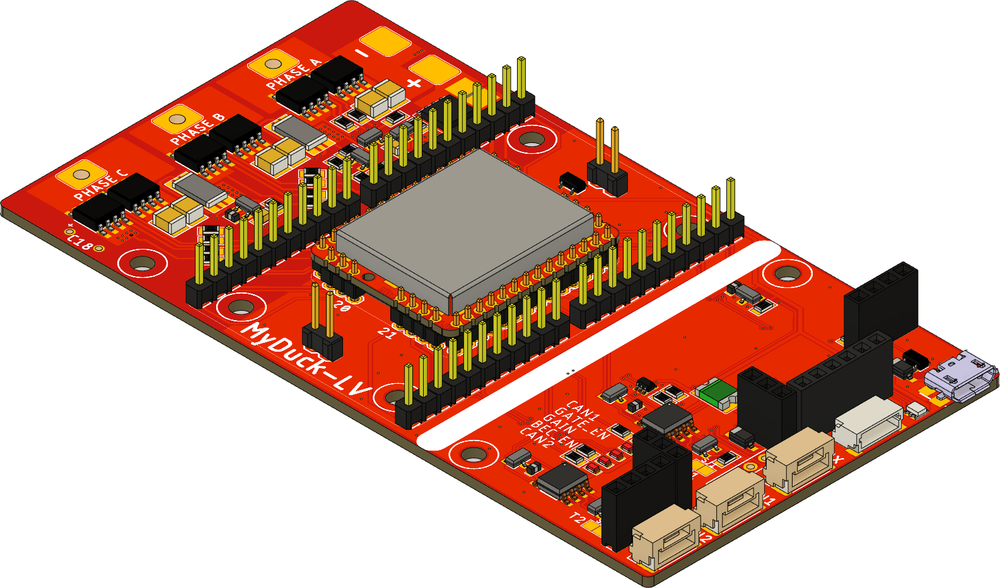
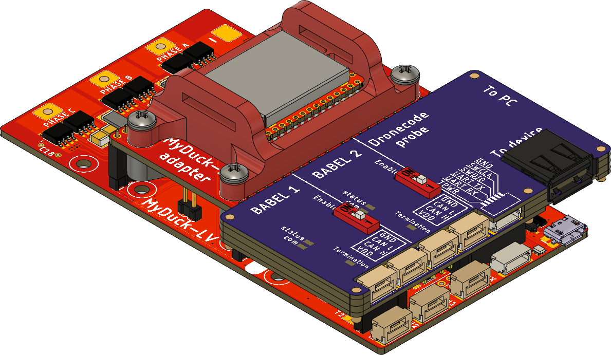

MyDuck LV is a dual-purpose device:

1) It can be used as a development board for [Mitochondrik LV](https://zubax.com/products/mitochondrik-lv). 
In this scenario, Mitochondrik LV is soldered directly to the PCB and turning MyDuck LV into a debug-friendly development board/PMSM motor controller.

2) It can serve as a tool for production flashing and testing Mitochondrik LV. 
In this scenario, Mitochondrik LV is mounted on the intermediate PCB using pogo pins. This PCB is then installed into MyDuck LV.
Mitochondrik LV can be aligned in place using 3D printed parts (red parts in the picture below). It then can be fixed either using a strip of aluminium (as suggested in the model)
or with a generic toggle clamp. MyDuck LV is designed to accept [Babel-Babel debugging tool](https://github.com/Zubax/Babel-Babel) directly. 

To perform flashing and testing the following steps should be taken:

1) Connect any PMSM motor to the phase connectors of MyDuck LV.
2) Install Babel-Babel on the MyDuck LV and connect it to the PC.
3) Connect the power supply to the MyDuck LV (observe the polarity!!!).
4) Install the Mitochondrik in place (observe the polarity, notice there is a mechanical key on the Mitochondrik PCB that should prevent incorrect placement).
5) Start testing sequence with drwatson like for any other Telega-based device.
6) Follow the instructions from drwatson.
7) Remove the Mitochondrik.
