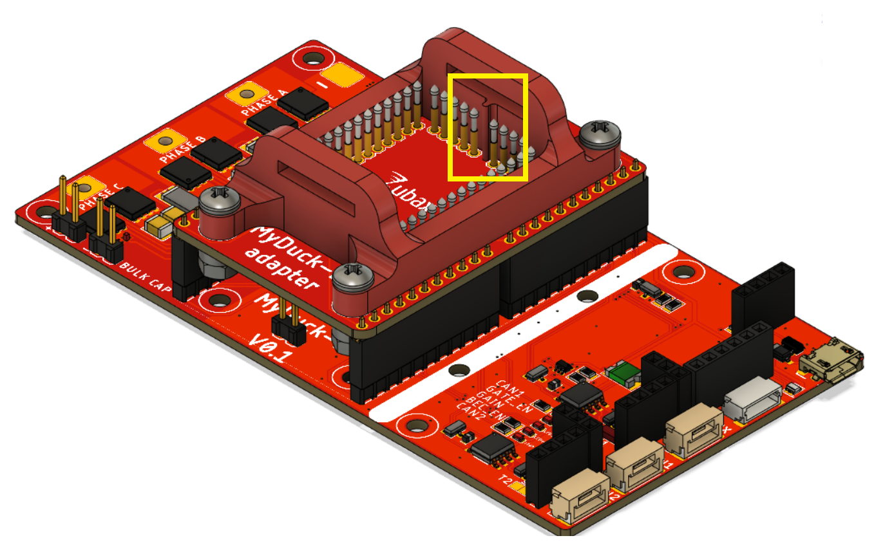
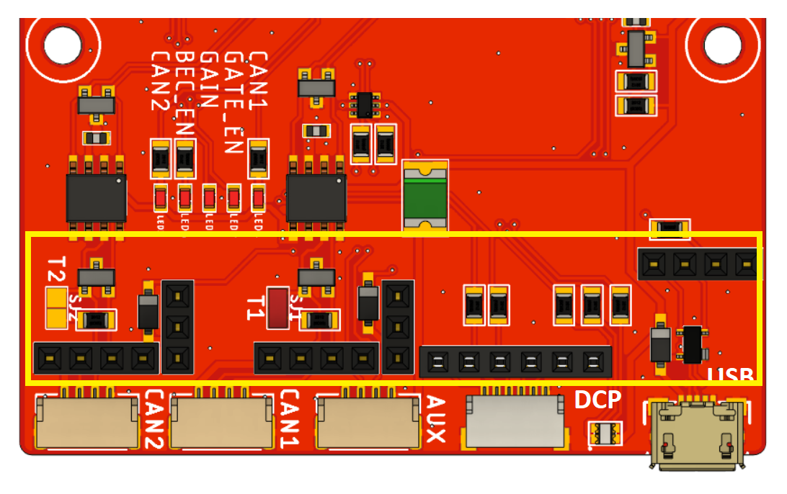

# MyDuck LV

MyDuck LV is a basic reference design and an evaluation board for the Zubax Mitochnodrik LV motor control module. When 
combined with Mitochondrik LV, it makes a complete PMSM motor controller. It is also a specialized jig (fixture) that 
allows easy flashing and testing of all functions of Mitochondrik LV during manufacturing.

**Note:** This design is not compatible with **Mitochondrik MV**.

## Features

All external signals of Mitochondrik LV are accessible when the Mitochondrik LV is installed on MyDuck LV. MyDuck LV 
can fanout 2 UAVCAN-compatible CAN interfaces, a USB interface, a Dronecode debug port and one AUX connector for GPIO
and RCPWM. Check out the picture below:

A switch has been implemented which prevents powering the device if Mitochondrik LV is not installed or installed 
incorrectly. Due to this feature, it is not required to remove the power supply every time before insertion of 
Mitochondrik LV. The Mitochondrik presence pin is low when Mitochondrik is inserted. Then, CAN_VDD should be set to 1, 
which turns on Q9, which then turns on Q11 allowing VDC to power the device. The CAN_VDD is connected to the GPIO PA4 
of babel. Babel would turn on the power supply during testing. The power supply switch is arranged in logic OR 
configuration, which means it's enable pin is attached to both of Babels and either one of them can turn it on.
Check out the hardware schematic below:

A mechanical key is introduced to prevent incorrect insertion of Mitochondrik LV.

Headers are available to install the [Babel-Babel production tool](https://github.com/Zubax/Babel-Babel)
directly to the MyDuck LV PCB without the need for an external adapter PCB.

| Stacked Babel-Babel | Babel-Babel headers |
| ------------------- | ------------------- |
|   |   |

## Specifications

* Supply voltage range: 13 - 51 V.
* Max continuous current/peak current: 10/20 A.
* Operating temperature range - 0...+40С.
* Humidity - up to 100%

## Manufacturing instructions

For details on the manufacturing process of the device, check the
instructions at `/docs/manufacturing.md`.

## Release notes

Newest entries at the top.

### MyDuck LV v1.0 (2021)

The original version.

### License

This project is licensed under the terms of [CC-BY 4.0](https://creativecommons.org/licenses/by/4.0/).
