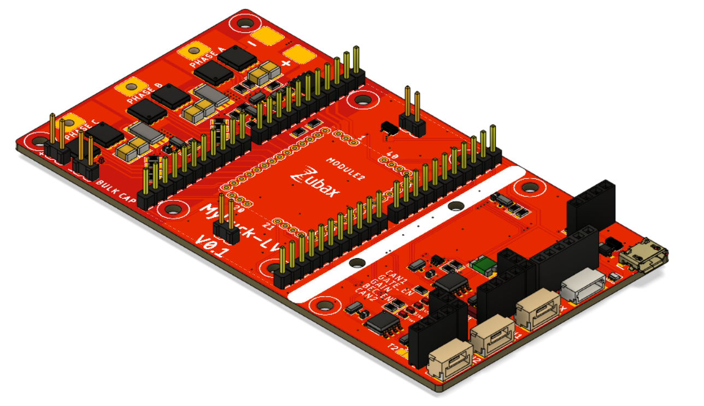
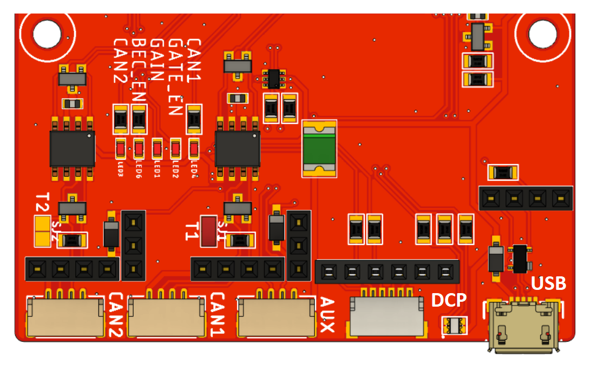
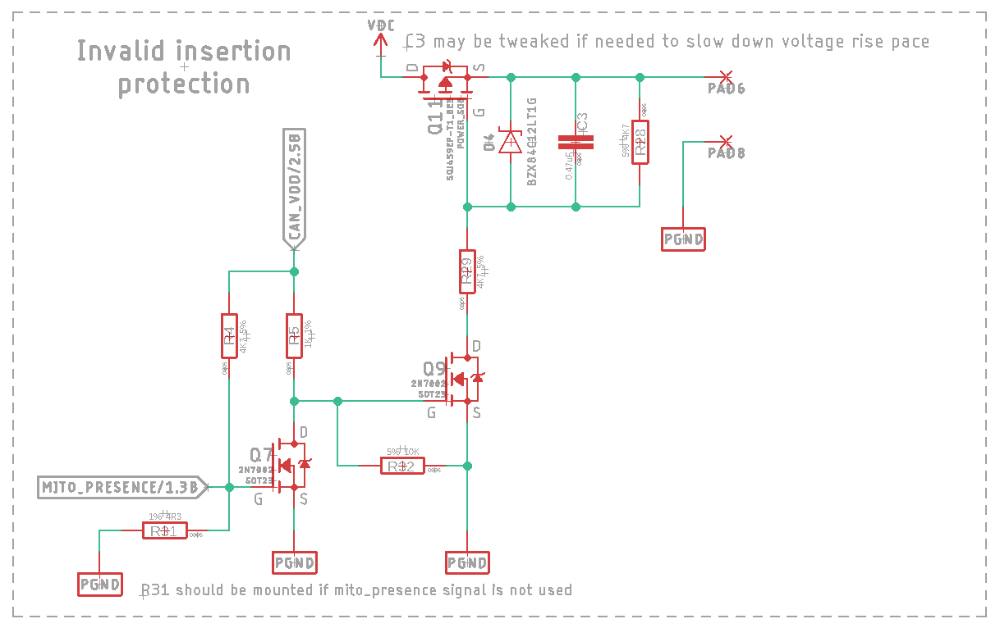
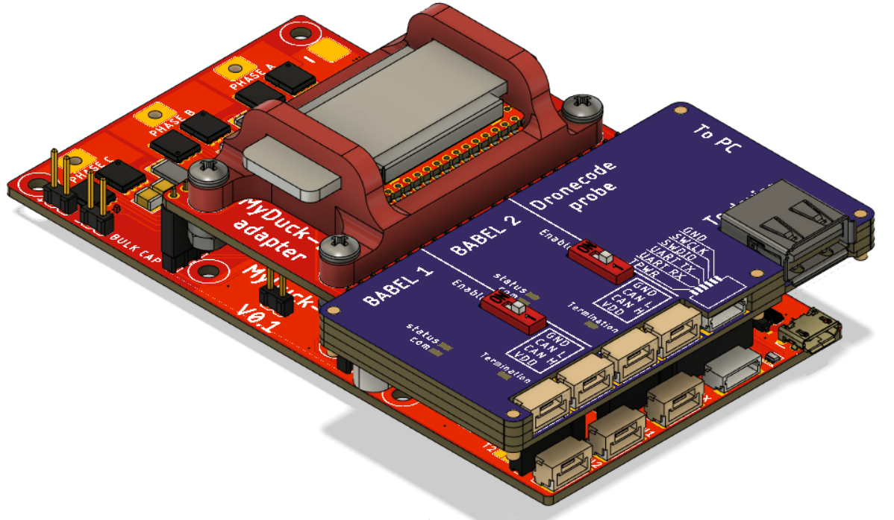

# MyDuck LV

MyDuck LV is a basic reference design and an evaluation board for the Zubax Mitochnodrik LV motor control module. MyDuck LV is a device when combined with Mitochondrik LV makes a complete PMSM motor controller. It is designed for the production of Mitochondrik LV. It is a specialized jig that allows easy flashing and testing of all functions of Mitochondrik LV. MyDuck LV can also be used as an evaluation board for Mitochondrik LV.

**Note:** This design is not compatible with **Mitochondrik MV**.

## Features

All external signals of Mitochondrik LV are accessible when the Mitochondrik LV is installed on MyDuck LV. MyDuck LV can fanout 2 UAVCAN-compatible CAN interfaces, a USB interface, a Dronecode debug port and one AUX connector for GPIO and RCPWM. Check out the picture below:

A switch has been implemented which prevents powering the device if Mitochondrik LV is not installed or installed incorrectly. Due to this feature, it is not required to remove the power supply every time before insertion of Mitochondrik LV. 
Mito presence goes low when mitochondrik is inserted. Then CAN_VDD should be set to 1, which turns on Q9,
which then turns on Q11 allowing VDC to power the device. The CAN_VDD is connected to the GPIO of babel. Babel 
would turned on power supply during the execution of production scripts Dr. Watson. Check out the hardware schematic below:

A mechanical key is introduced to prevent incorrect insertion of Mitochondrik LV.

Headers are availabe to install [Babel-Babel production tool](https://zubax.com/products/mitochondrik-lv)
directly to the MyDuck LV PCB without the need for an external adapter PCB.

| Stacked Babel-Babel | Babel-Babel headers |
| ------------------- | ------------------- |
|   |   |

## Manufacturing instructions

For details on the manufacturing process of the device, check the
[manufacturing instructions](https://github.com/Zubax/MyDuck-LV/blob/master/manufacturing.md).

## Release notes

Newest entries at the top.

### MyDuck LV v1.0 (2021)

The original version.

## Specifications

* Supply voltage range: 13 - 51 V.
* Max continuous current/peak current: 10/20 A.
* Operating temperature range - 0...+40С.
* Humidity - up to 100%

