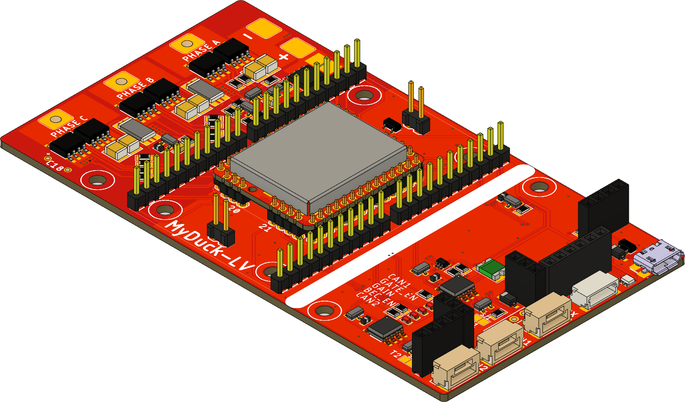
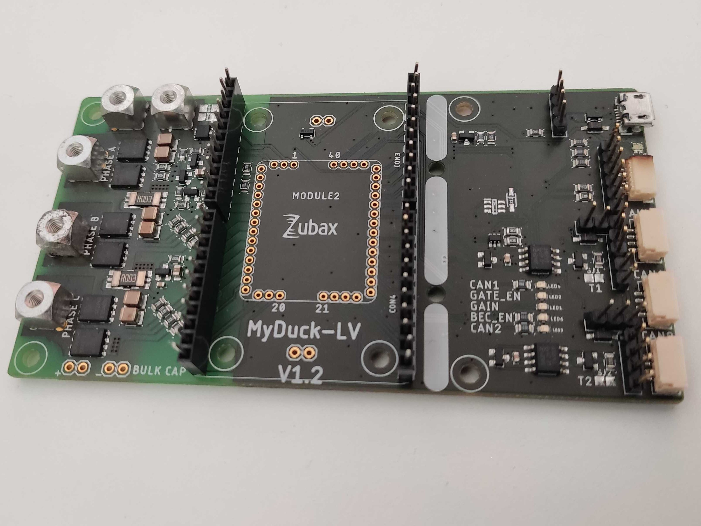
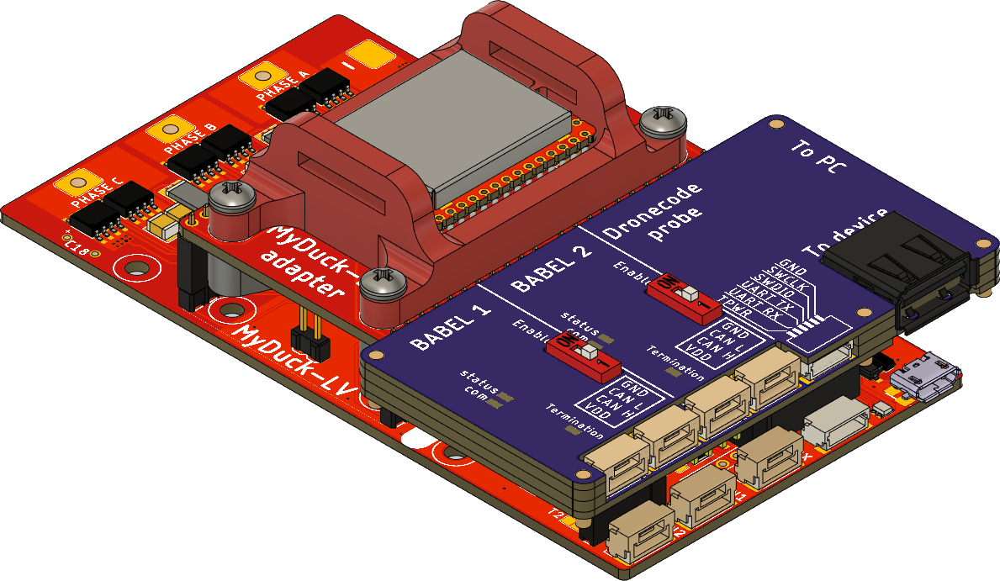
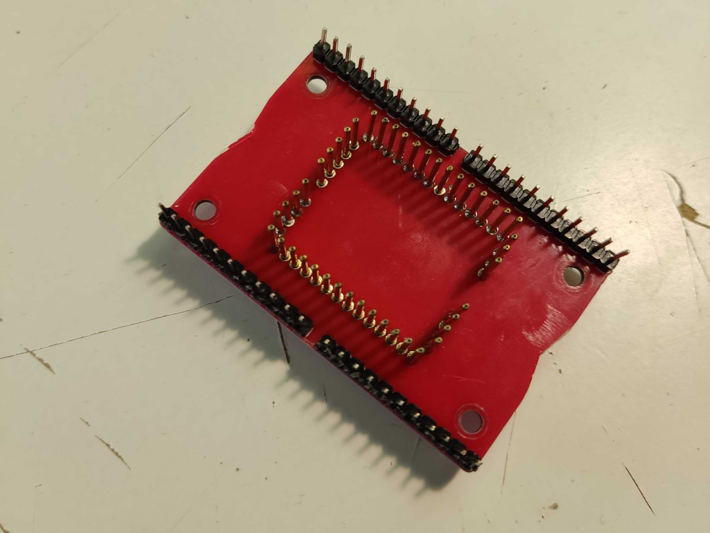
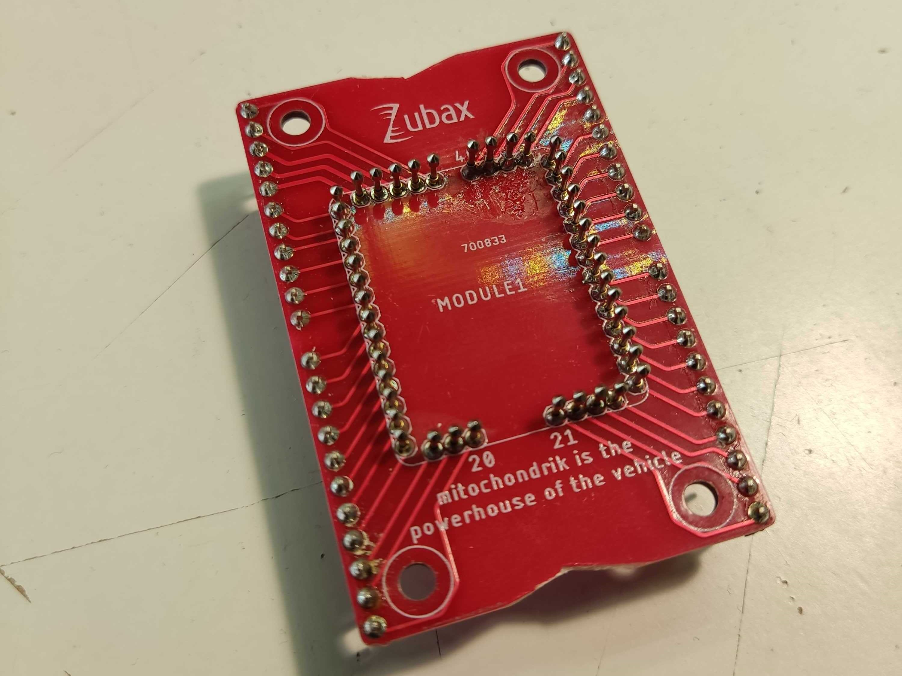
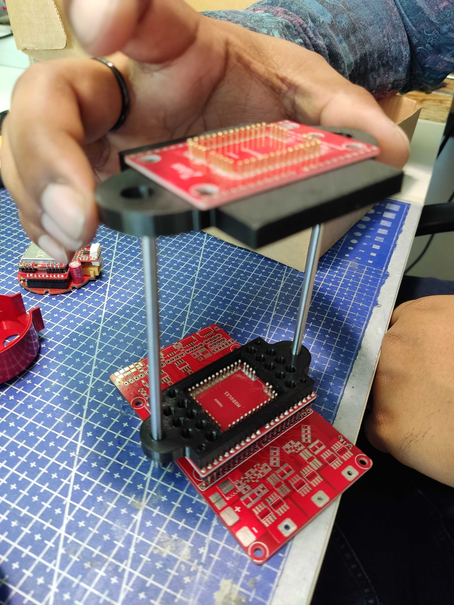

# Manufacturing instructions

## Evaluation board
Mitochondrik Evaluation Board LV can be used as an evaluation board for Mitochondrik LV. In this scenario, Mitochondrik LV is soldered 
directly to the PCB, turning Mitochondrik Evaluation Board LV into a debug-friendly evaluation board or a PMSM motor controller.

To manufacture the device as an evaluation board, only the main PCB should be assembled.
No special instruction is needed, the main PCB should be used to generate BOM and PnP files.
As the mitochondrik footprint is populated using PLS2 male connectors,
the module installed on the PCB should be equipped with appropriate mating connectors.
The reference photo can be seen below.

The blow scheme for this usage scenario can be seen below.

## Production tool

Mitochondrik Evaluation Board LV can serve as a tool for production flashing and testing of Mitochondrik LV (line checkout fixture).
In this scenario, Mitochondrik LV is mounted on an intermediate PCB using pogo pins.
This PCB is then installed into Mitochondrik Evaluation Board LV.
Mitochondrik LV can be aligned in place using 3D-printed parts (red parts in the picture below).
It can then be fixed using a strip of aluminum (as suggested in the model) or with a generic toggle clamp.
Mitochondrik Evaluation Board LV is designed to accept the [Babel-Babel debugging tool](https://github.com/Zubax/Babel-Babel) directly.

To use the device as a production tool, two PCBs should be manufactured. The main PCB should be used to generate
BOM and PnP files.

The blow scheme for this usage scenario can be seen below.

Besides that, the adapter PCB should also be manufactured. 
Solder 2 mm header pins & pogo pins to the adapter PCB.
A fully assembled adapter PCB can be seen in the pictures below.

Besides the 4x PBS11 connectors, the PCB also contains 44 pogo pins and a 3D-printed holder for the Mitochondrik module.
The pogo pins should be installed perpendicular to the surface of the PCB at the correct height.
As it may be tricky to do it by hand, it is recommended to use a special 3D-printed tool.
It can be seen in the picture below.

The tool should be placed UNDER the PCB and aligned with all the holes on the PCB.
It can be temporarily fixed in place using M3 screws.
After that, the pins can be pushed into the tool through the PCB from the top.
The pins should be pushed until the lower tip of the pin is flush with the lower surface of the tool
(this guarantees the correct height of the pin relative to the top surface of the PCB).
After that, the pins can be soldered from the top side of the PCB.
The tool is single-use and cannot be removed from the device after the pins are mounted.
After the pogo pins are installed, the 3D-printed holder should be secured in place using 4x 8-12 mm M3 screws
and 4x M3 nuts.

The adapter blow scheme can be seen below.

Bolt the 3D Bottom Holder to the adapter board with 4x M3 screws from underneath. 
Insert 4 mm metallic rods on both sides of the 3D Bottom Holder.
Assemble the second adapter board with pogo pins facing the opposite direction.
Ensure that the pogo pins of the top and bottom parts can make contact with each other
when the top part is pushed all the way down.
Bolt the 3D Top Holder to the second adapter board with 4x M3 screws from the top.
Insert linear bearings into the outer holes of the 3D Top Holder and apply glue.
Insert the 3D Top Holder and second adapter board assembly through the 4 mm metallic rods.
Connect the top and bottom adapter boards with a 1.27mm ribbon cable.

### BOM for final assembly of Mitochondrik Evaluation Board LV (customer variant)

| Name                                 | Quantity |
| ------------------------------------ | -------- |
| Mitochondrik Evaluation Board LV PCB | 1 |            

### BOM for final assembly of Mitochondrik Evaluation Board LV as production tool (manufacturer variant)

| Name                                 | Quantity |
| ------------------------------------ | -------- |
| Adapter assembly                     | 2 |
| Mitochondrik Evaluation Board LV PCB | 1 |       
| Babel-Babel                          | 1 |      

### BOM required for the manufacturing of Adapter assembly.

| Name                     | Quantity |
| ------------------------ | -------- |
| Adapter PCB              | 1 |
| PBS11 female connectors  | 4 |
| Pogo pins                | 44 |
| Pogo pins soldering rail | 1 |  
| M3 x 12mm screw          | 12 |   
| M3 nut                   | 12 |
| Mitochondrik holder      | 1 |
| Aluminium/Plastic lock   | 1 |
| 4 mm linear guide        | 2 |
| 4 mm linear bearing      | 2 |
| 44 pin Ribbon connector  | 1 |
| 3D Top Holder            | 1 |
| 3D Bottom Holder         | 1 |
